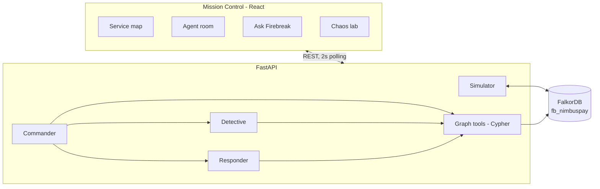
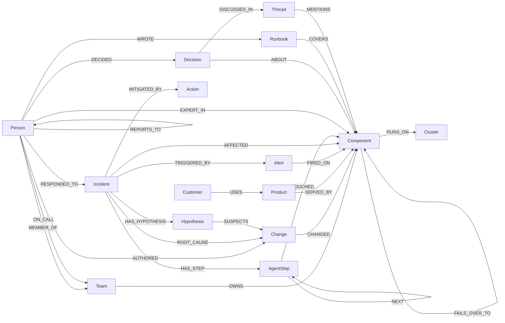

# Firebreak

**The AI incident commander that thinks in graphs.** Stop incidents from spreading.

Built for **Graph Hacks: Context for AI Agents** (WeMakeDevs × FalkorDB).
Tracks: **01 · Agents That Act on Connected Data**, **02 · Agent Memory and Coordination**, **03 · Company Brain**.

When production breaks, the alert fires on the service customers touch, but the cause is usually two
to four dependency hops away, in a service that never alerted. Firebreak puts a company's operational
context (services, dependencies, deploys, people, on-call, customers, runbooks, decisions and every past
incident) into one FalkorDB graph. A three-agent team works that graph during a live incident:

- **Detective** traces alerts down `DEPENDS_ON` paths to recent changes and ranks root causes.
- **Responder** finds the owning team, current on-call and the people who actually know the system.
- **Commander** sizes blast radius and business impact, writes the verdict with an evidence path,
  and proposes an action for a human to approve.

Engineers can also ask the company brain questions ("Why does checkout call auth synchronously?") and
get answers with cited sources.

> FalkorDB is the source of truth for everything: the simulator reads topology from it and writes health
> and alerts back, every agent tool is a Cypher query, agents coordinate through nodes in it, and memory
> lives in it. Remove FalkorDB and nothing works.


## Quick start

One command (Docker only):

```bash
docker compose up --build
```

Open **http://localhost:8000** for Mission Control. The graph `fb_nimbuspay` is seeded on first start.
FalkorDB Browser is at http://localhost:3000 (select graph `fb_nimbuspay`).

Firebreak runs fully **deterministic by default** (zero LLM calls; the graph decides everything). To let
an LLM write the verdict narrative and postmortems, copy `.env.example` to `.env` and set:

```bash
LLM_PROVIDER=gemini
LLM_API_KEYS=key1,key2        # free-tier Gemini keys; rotated on 429
```

Any OpenAI-compatible endpoint works by changing `LLM_BASE_URL` and `LLM_MODEL`. The LLM never chooses
the root cause: its narrative is discarded unless it cites the graph-chosen cause, and every failure falls
back to a template.

### Local development

Requirements: Docker, [uv](https://docs.astral.sh/uv/), Node 20+.

```bash
docker compose up -d falkordb
cd backend && uv sync
uv run python -m firebreak.seed
uv run uvicorn firebreak.api:app --port 8000
```

```bash
cd frontend && npm install && npm run dev   # http://localhost:5173, proxies /api to :8000
```

### Verify without the UI

```bash
cd backend
uv run pytest                               # unit + integration + MCP tests against FalkorDB
uv run python -m firebreak.cli acceptance   # every scenario: verdict, decoy rejected, approve, green
uv run python -m firebreak.benchmark        # 16 generated scenarios vs baselines -> docs/benchmark.md
```

### Use the graph tools from any MCP client

```json
{
  "mcpServers": {
    "firebreak": {
      "command": "uv",
      "args": ["run", "--directory", "/path/to/Graph-Hack/backend", "python", "-m", "firebreak.mcp_server"]
    }
  }
}
```

Tools: `rank_root_causes`, `blast_radius`, `evidence_path`, `who_knows`, `similar_incidents`,
`ask_company_brain`. All read-only. `python -m firebreak.mcp_server --http` serves streamable HTTP on
`127.0.0.1:8001/mcp`.

### Demo controls

| Key | Action |
|---|---|
| `1`–`4` | Inject a chaos scenario (with decoy change) |
| `E` | Animate the evidence path |
| `Ctrl+K` | Ask Firebreak |
| `M` | Memory panel (playbooks, recall history) |

Demo video script: [docs/demo-script.md](docs/demo-script.md). Blog post draft: [docs/blog.md](docs/blog.md).

## How it works



1. **Inject.** The chaos lab sets a fault on one component and writes the causing `Change` node, plus a
   decoy change on a component that no alerting service depends on.
2. **Spread.** The simulator reads `DEPENDS_ON` from the graph and propagates: `sync` edges carry errors
   and latency to callers, `async` edges carry only lag. Alert rules fire on customer-facing components
   only, so the cause itself does not alert.
3. **Investigate.** Alerts within 2 minutes correlate into an `Incident`. The Commander dispatches the
   Detective and Responder in parallel (`asyncio.gather`). Neither returns findings to the other: they
   write `Hypothesis` and `AgentStep` nodes, and the Commander reads the blackboard back from FalkorDB.
4. **Verdict.** The Commander writes `(:Incident)-[:ROOT_CAUSE]->(:Change)`, the evidence path, blast
   radius and customer impact, and proposes `Action` nodes (`rollback`, `failover`, `flag_off`, `page`).
5. **Remember.** Before deciding, the Commander recalls similar past incidents (vector search over
   `Incident.embedding` plus overlap of affected components). If one had the same root cause, the verdict
   says "Seen before: INC-2093, rollback fixed it in 6 min" and confidence rises, shown as its own bar.
6. **Act.** A human approves. The fault clears, the change is marked reverted and the map turns green.
7. **Learn.** The Scribe writes a `Postmortem`, links `SIMILAR_TO` incidents, bumps the `Playbook`
   success count and raises `EXPERT_IN` for the responders. The next similar incident is recognized
   faster and the proposed fix cites its track record ("playbook: 3/3 past successes").

### Memory

| Kind | In the graph | Used for |
|---|---|---|
| Episodic | `Incident` (+ 384-d `embedding`, local bge-small), `AgentStep`, `Postmortem`, `SIMILAR_TO` | "Seen before" recall, full replay of every investigation |
| Procedural | `Playbook {success_count, failure_count}` -`FOR`-> `Component` | Ranking and justifying remediations |
| Semantic | `EXPERT_IN {score}`, `RESPONDED_TO`, decisions and runbooks | Who to page, who knows the system |
| Per tenant | one graph per tenant (`fb_nimbuspay`, `fb_bench`, `fb_acceptance`, …) | Isolation without separate deployments |

### Root-cause scoring

```
score(c) = coverage(c) × (0.45·change + 0.25·anomaly + 0.20·history + 0.30·vendor) + 0.05·criticality(c)
```

| Signal | Meaning |
|---|---|
| coverage | share of alerting services whose dependency closure contains `c` |
| change | strongest recent change on `c`: `exp(-Δt / 30 min) × risk weight` |
| anomaly | `c` is degraded and none of its sync dependencies are (it is an origin, not a symptom) |
| history | share of past incidents whose root cause was on `c` |
| vendor | `c` is an external vendor and degraded |
| criticality | FalkorDB **PageRank** of `c` over `DEPENDS_ON`, normalized to the max (rank flows through chains, so a deep shared dependency beats a leaf with many callers) |

Confidence is normalized across candidates with direct evidence, and a candidate that explains zero
alerts gets none. A decoy change on a component no alerting service depends on has coverage 0, so its
recency counts for nothing. That is exactly where a "most recent deploy" heuristic or a flat-context LLM
goes wrong. Memory then closes part of the remaining doubt when a past incident had the same cause.

Built-in scenarios, deterministic mode, no LLM calls:

| Scenario | Root cause found | Confidence | Decoy rejected |
|---|---|---|---|
| Bad deploy on auth-service | deploy `D-4521` by Priya Raman | 94% | `D-4522` on search-service |
| Stripe partial outage | `stripe` (vendor) | 88% | `C-7710` on notifications-service |
| Risk model flag regression | flag `F-0091` by Ivan Petrov | 90% | `D-4530` on reporting-service |
| Migration lock on postgres-ledger | migration `M-0450` by Maya Patel | 85% | `C-7715` on search-index |

### Benchmark

16 scenarios generated from the topology (not hand-picked), each with a decoy; in 11 the decoy is more
recent than the real cause. Full table: [docs/benchmark.md](docs/benchmark.md).

| Method | Top-1 accuracy | LLM calls / incident |
|---|---|---|
| **Firebreak** (graph RCA, deterministic) | **100%** | 0 |
| Flat-context LLM (Gemini 3.5 Flash-Lite, same alerts and changes, no topology) | 75% | 1 |
| Most recent change | 31% | 0 |

The flat LLM is scored leniently (naming the right component counts). It misses vendor outages and
causes that are several hops from the alert, because nothing in a flat list says what depends on what.
Scoring weights were set before the benchmark existed; the benchmark did catch one bug (a degraded
component off every alert path could still get confidence), which was fixed in the engine, not by tuning.

## Graph data model

One graph per tenant (`fb_<tenant>`). The demo tenant **NimbusPay** is a fictional fintech:
35 components, 6 teams, 19 people, 5 products, 5 customers, ~80 changes over 90 days, 15 past
incidents, 5 ADRs, 5 runbooks and 8 Slack threads. All data is synthetic.



| Label | Key properties |
|---|---|
| `Component` (+ `Service` / `Datastore` / `Queue` / `Vendor` / `Cluster`) | `name`, `kind`, `tier`, `status`, `customer_facing`, baseline and live metrics |
| `Team`, `Person` | `name`, `slack_channel` · `id`, `name`, `title`, `timezone` |
| `Product`, `Customer` | `name` · `id`, `name`, `tier`, `arr_usd`, `sla_target` |
| `Change` | `id`, `kind` (deploy/config/flag/migration), `version`, `summary`, `risk`, `ts`, `reverted_at` |
| `Alert`, `Incident` | `rule`, `value`, `status` · `severity`, `status`, `started_at` … `resolved_at`, `confidence` |
| `Hypothesis`, `AgentStep`, `Action` | blackboard: `statement`, `confidence`, `status`, `breakdown` · `agent`, `tool`, `cypher`, `model` · `kind`, `target`, `status`, `approved_by` |
| `Decision`, `Runbook`, `Thread` | company knowledge with full-text indexes |

Edge properties that matter: `DEPENDS_ON.mode` (`sync` / `async`), `USES.gmv_per_hour_usd`,
`ON_CALL.level / from / until`, `EXPERT_IN.score`, `ROOT_CAUSE.confidence`.

Memory labels: `Postmortem` -`DOCUMENTS`-> `Incident`, `Playbook` -`FOR`-> `Component`,
`(Incident)-[:SIMILAR_TO {score}]->(Incident)`.

**Indexes:** range indexes on every lookup key, full-text on `Decision`, `Runbook`, `Thread`,
`Incident` and `Postmortem`, and a 384-d cosine vector index on `Incident.embedding` (local
`BAAI/bge-small-en-v1.5` via fastembed, no API quota).

## Cypher queries

These are the queries the agents run, copied from [`backend/firebreak/tools.py`](backend/firebreak/tools.py).
All of them run in CI against a FalkorDB service container.

**Root-cause coverage** (Detective): every component reachable from the alerting set, how many alerts
it explains, and whether it is a fault origin.

```cypher
UNWIND $alerting AS a
MATCH (s:Component {name: a})
MATCH p = (s)-[:DEPENDS_ON*0..6]->(c:Component)
WITH c, a, min(length(p)) AS hops
WITH c, collect({alert: a, hops: hops}) AS explains
OPTIONAL MATCH (c)-[:DEPENDS_ON {mode: 'sync'}]->(d:Component) WHERE d.status <> 'healthy'
RETURN c.name AS candidate, c.kind AS kind, c.status AS status, explains,
       count(d) = 0 AS origin
```

**Recent changes with authors** (Detective):

```cypher
MATCH (ch:Change)-[:CHANGED]->(c:Component)
WHERE ch.ts >= $since AND ch.ts <= $until AND ch.reverted_at IS NULL
OPTIONAL MATCH (author:Person)-[:AUTHORED]->(ch)
RETURN c.name AS component, c.kind AS kind, c.status AS status, ch.id AS change, ch.kind AS change_kind,
       ch.summary AS summary, ch.risk AS risk, ch.ts AS ts, author.name AS author
ORDER BY ch.ts DESC
```

**Evidence path** (Commander): the shortest dependency path from an alert to the verdict.

```cypher
MATCH (a:Component {name: $alerting}), (c:Component {name: $candidate})
MATCH p = (a)-[:DEPENDS_ON*0..6]->(c)
RETURN [n IN nodes(p) | n.name] AS path, length(p) AS hops
ORDER BY hops ASC LIMIT 1
```

**Blast radius** (Commander): everything that transitively depends on a component.

```cypher
MATCH (root:Component {name: $name})
MATCH p = (up:Component)-[:DEPENDS_ON*1..6]->(root)
WITH up, p, all(r IN relationships(p) WHERE r.mode = 'sync') AS hard
WITH up, min(length(p)) AS hops, max(CASE WHEN hard THEN 1 ELSE 0 END) AS anyHard
RETURN up.name AS component, up.tier AS tier, hops,
       CASE WHEN anyHard = 1 THEN 'down' ELSE 'degraded' END AS impact
ORDER BY hops, tier
```

**Business impact** (Commander): customers and GMV per hour exposed through products.

```cypher
MATCH (root:Component {name: $name})
MATCH (entry:Component)-[:DEPENDS_ON*0..6]->(root)
MATCH (prod:Product)-[:SERVED_BY]->(entry)
WITH DISTINCT prod
MATCH (c:Customer)-[u:USES]->(prod)
RETURN c.id AS id, c.name AS customer, c.tier AS tier, c.sla_target AS sla,
       collect(prod.name) AS products, sum(u.gmv_per_hour_usd) AS gmv_per_hour
ORDER BY gmv_per_hour DESC
```

**On-call and escalation** (Responder):

```cypher
MATCH (c:Component {name: $name})<-[:OWNS]-(t:Team)
OPTIONAL MATCH (p:Person)-[oc:ON_CALL]->(t)
  WHERE oc.from <= $now AND oc.until > $now
OPTIONAL MATCH (p)-[:REPORTS_TO*1..2]->(mgr:Person)
RETURN t.name AS team, t.slack_channel AS channel, p.id AS id, p.name AS on_call, oc.level AS level,
       collect(DISTINCT mgr.name) AS escalation
ORDER BY level
```

**Who knows this system** (Responder): people who responded to incidents on it, wrote its runbooks,
changed it, or have learned expertise. Weighted in Python (responded ×3, runbook ×2, authored ×1,
plus `EXPERT_IN.score`).

```cypher
MATCH (c:Component {name: $name})
OPTIONAL MATCH (p1:Person)-[:RESPONDED_TO]->(i:Incident)
  WHERE (i)-[:AFFECTED]->(c) OR (i)-[:ROOT_CAUSE]->(c) OR (i)-[:ROOT_CAUSE]->(:Change)-[:CHANGED]->(c)
WITH c, collect(DISTINCT p1.id) AS responded
OPTIONAL MATCH (p2:Person)-[:AUTHORED]->(:Change)-[:CHANGED]->(c)
WITH c, responded, collect(DISTINCT p2.id) AS authored
OPTIONAL MATCH (p3:Person)-[:WROTE]->(:Runbook)-[:COVERS]->(c)
WITH c, responded, authored, collect(DISTINCT p3.id) AS wrote
OPTIONAL MATCH (p4:Person)-[e:EXPERT_IN]->(c)
RETURN responded, authored, wrote, collect({id: p4.id, score: e.score}) AS learned
```

**FalkorDB graph algorithms** (from [`graph_algos.py`](backend/firebreak/graph_algos.py)). These run
inside the database, not in Python, and feed the RCA engine and the single-points-of-failure view.
Cached for 5s and written back onto `Component.page_rank` / `Component.betweenness` so they are
inspectable in the FalkorDB Browser.

```cypher
CALL algo.pageRank('Component', 'DEPENDS_ON') YIELD node, score
RETURN node.name AS name, score
```

```cypher
CALL algo.betweenness({nodeLabels: ['Component'], relationshipTypes: ['DEPENDS_ON'],
                       samplingSize: 32, samplingSeed: 42})
YIELD node, score RETURN node.name AS name, score
```

Betweenness is pinned to seed 42 so a demo replays identically. On the demo graph the top choke
points are `checkout-api` (63.0), `payments-core` (40.5) and `auth-service` (22.0); those are the
components where one failure severs the most unrelated dependency paths.

**Similar incidents** (Commander, from [`memory.py`](backend/firebreak/memory.py)): vector search
plus structural overlap, with the root cause and the fix that worked. FalkorDB returns cosine
distance; Python ranks by `0.7 × (1 − distance) + 0.3 × overlap`.

```cypher
CALL db.idx.vector.queryNodes('Incident', 'embedding', $k, vecf32($vec)) YIELD node, score
WHERE node.id <> $current AND node.status = 'resolved'
OPTIONAL MATCH (node)-[:AFFECTED]->(comp:Component) WHERE comp.name IN $affected
WITH node, score, count(DISTINCT comp) AS overlap
OPTIONAL MATCH (node)-[:ROOT_CAUSE]->(rc)
OPTIONAL MATCH (rc)-[:CHANGED]->(rcc:Component)
OPTIONAL MATCH (node)-[:MITIGATED_BY]->(a:Action) WHERE a.status = 'executed' AND a.kind <> 'page'
RETURN node.id AS id, node.title AS title, node.summary AS summary, score AS distance, overlap,
       coalesce(rcc.name, rc.name) AS rc_component, rc.id AS rc_change, rc.kind AS rc_kind,
       collect(DISTINCT a.kind) AS actions,
       node.started_at AS started_at, node.mitigated_at AS mitigated_at
```

**Company brain retrieval** (Ask Firebreak): full-text search plus the decision's people, components and
source threads.

```cypher
CALL db.idx.fulltext.queryNodes('Decision', $q) YIELD node, score
OPTIONAL MATCH (node)-[:ABOUT]->(c:Component)
OPTIONAL MATCH (p:Person)-[:DECIDED]->(node)
OPTIONAL MATCH (node)-[:DISCUSSED_IN]->(t:Thread)
RETURN 'Decision' AS type, node.id AS id, node.title AS title, node.decision AS text,
       collect(DISTINCT c.name) AS components, collect(DISTINCT p.name) AS people,
       collect(DISTINCT t.id) AS threads, score
ORDER BY score DESC LIMIT 5
```

## Track mapping

| Track | What Firebreak does |
|---|---|
| **01 · Act on connected data** | Multi-hop RCA over up to 6 `DEPENDS_ON` hops; graph queries as agent tools, also exposed over **MCP**; actions chosen from graph evidence and approved by a human; every verdict has a score breakdown, evidence path and recorded Cypher trace; benchmarked against baselines. |
| **02 · Memory and coordination** | Detective and Responder run concurrently and coordinate only through `Hypothesis` / `AgentStep` nodes; episodic (incidents + vector recall), procedural (playbook success counts) and semantic (learned expertise) memory, all updated by the Scribe after every incident; one graph per tenant. |
| **03 · Company brain** | ADRs, runbooks and Slack threads linked to components and people; ownership, on-call and expertise; decisions traced to who decided and where it was discussed; answers cite their sources and highlight them on the map. |

## Project layout

```
backend/firebreak/
  seed_data.py    synthetic NimbusPay world (pure data)
  seed.py         loads it into FalkorDB with indexes
  simulator.py    fault propagation, alert rules, chaos scenarios
  rca.py          root-cause scoring (pure functions)
  tools.py        Cypher graph tools used by the agents
  agents.py       Commander, Detective, Responder
  memory.py       recall, playbooks, Scribe, learning curve
  embeddings.py   local 384-d embeddings (fastembed)
  llm.py          OpenAI-compatible gateway: key rotation, rate limit, cache, fallback
  incidents.py    correlation, lifecycle, human-approved actions
  brain.py        Ask Firebreak
  mcp_server.py   graph tools over MCP
  benchmark.py    generated scenarios vs baselines
  api.py          FastAPI app (also serves the built UI)
  cli.py          headless loop + acceptance gate
frontend/src/     Mission Control (React, React Flow, Tailwind)
docs/             PRD, benchmark results
```

## AI assistance disclosure

This project was built with the help of an AI coding assistant, used for code generation, refactoring
and documentation. The design, data model and scoring approach are documented above and in
[docs/PRD.md](docs/PRD.md).
