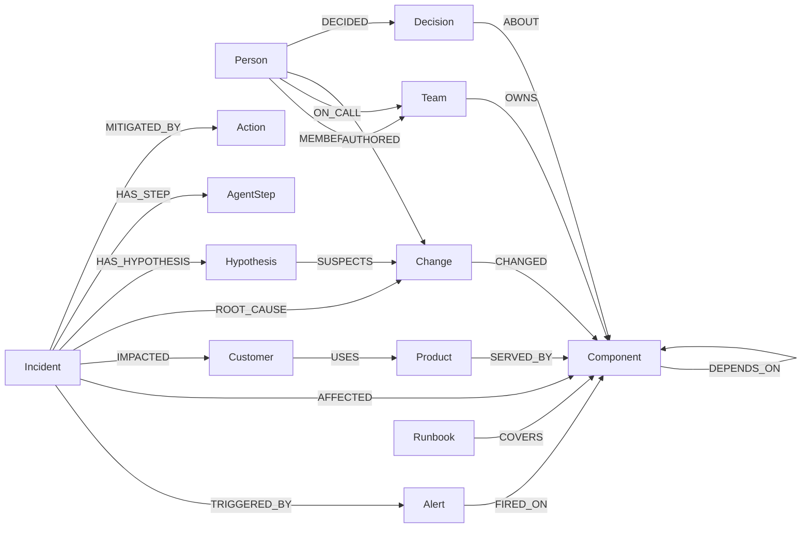
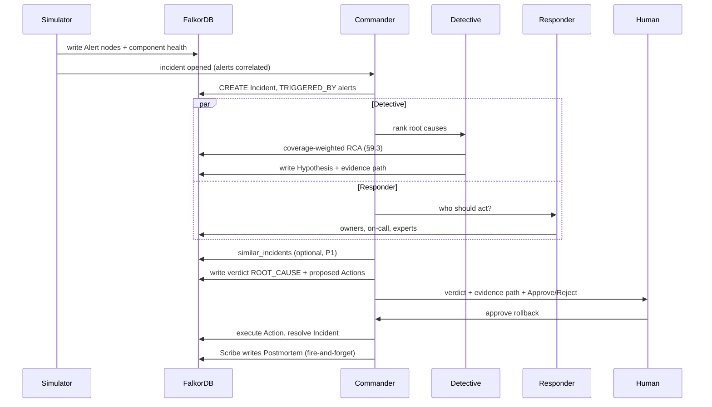

# Firebreak — Product Requirements Document

| | |
|---|---|
| **Product** | Firebreak — the AI incident commander that thinks in graphs |
| **Tagline** | Stop incidents from spreading. |
| **Event** | Graph Hacks: Context for AI Agents (WeMakeDevs × FalkorDB) |
| **Tracks entered** | Track 01 · Agents That Act on Connected Data · Track 02 · Agent Memory and Coordination · Track 03 · Company Brain |
| **Deadline** | Oct 18, 2026, 11:59 PM IST (internal submit target: 9:00 PM IST) |
| **Status** | **v1.1 — cut for build** (v1.0 was vision; this is the execution spec) |
| **Owner** | Rahul (solo builder), with an AI coding assistant (disclosed per rules) |
| **Constraints** | No paid LLM keys · Gemini free-tier only · Docker on `D:\Docker` (C: full) · Windows 11 + MSIX sandbox |

> **How to read this doc:** §6 lists every requirement but only §6.1–§6.4 marked **TRUE P0** block the demo. Everything else is P1 (only if core loop is green by Oct 17 12:00 IST) or CUT (deleted for this hackathon). Build in dependency order (§17).

---

## 1. TL;DR

When production breaks, every question is about **connections**: *What changed? What depends on it? Which customers are hit? Who knows how to fix it? Have we seen this before?*

Firebreak puts a company's entire operational context — services, dependencies, deploys, people, on-call, customers, runbooks, and every past incident — into a **single FalkorDB knowledge graph**. During a live incident a **3-agent team** works that graph:

1. **Commander** — orchestrates, sizes blast radius + business impact, merges findings into a verdict with a **clickable evidence path** and a proposed action for a human to approve.
2. **Detective** — finds the root cause by tracing alerts down dependency paths to recent changes (multi-hop RCA engine). Beating the decoy is the proof the graph matters.
3. **Responder** — finds the owner team, the on-call engineer, and the people who actually know the system.

A fire-and-forget **Scribe** step writes the postmortem back into the graph so the next similar incident is solved faster. Engineers can also **ask the company brain** anything ("Why does checkout call auth synchronously?") and get answers with cited sources.

**Primary demo mode is deterministic** (graph engines only, zero LLM calls). LLM adds narrative polish if quota allows. The demo never dies to a 429.

---

## 2. Problem

### 2.1 The pain
- **Symptoms appear far from causes.** Alerts fire on customer-facing services; the root cause is usually 2–4 dependency hops away, in a service that did not alert.
- **Context is scattered.** Topology in a service catalog, deploys in CI, owners in a wiki, on-call in a pager tool, decisions in Slack, history in old postmortems. Responders stitch it together by hand at 3 AM.
- **Knowledge walks out the door.** The engineer who fixed the same failure 4 months ago is the fastest path — but nothing connects today's incident to them.
- **Organizations don't learn.** Postmortems are written and forgotten; the same incident class recurs.

### 2.2 Why current AI agents fail here
LLM agents fed flat context (a list of alerts, deploys, docs) **guess** — they pick the most recent deploy, miss multi-hop dependencies, can't say *why*, and forget everything between sessions. The hackathon brief says it plainly: *"Agents see pieces, not the whole picture."*

### 2.3 Why a graph is the right primitive
Every incident question is a traversal:

| Question | Graph operation |
|---|---|
| What breaks if `auth-service` goes down? | Reverse `DEPENDS_ON*` traversal + `Product`/`Customer` join |
| What changed on the path between alert and cause? | Variable-length path + `Change` filter by time |
| Who has worked on this system before? | `Person → Change/Incident/Runbook → Component` aggregation |
| Have we seen this before? | Vector similarity **plus** structural overlap of affected subgraphs |
| Which services are single points of failure? | Betweenness centrality / PageRank on the dependency graph |
| Why is it built this way? | `Decision → ABOUT → Component`, `Person → DECIDED` |

---

## 3. Goals and non-goals

### 3.1 Goals (measurable, demo-judged)
| ID | Goal | How we prove it |
|---|---|---|
| G1 | **Correct root cause** — beat flat-context baseline and "most recent deploy" on the benchmark | Benchmark table in README (target ≥ 85% top-1; 90% is stretch) |
| G2 | **Every verdict is traceable** — evidence path + confidence breakdown + recorded agent steps in the graph | Click "Show evidence path" animates hop-by-hop; open Cypher in Browser |
| G3 | **Memory compounds** — recurring incident is diagnosed faster/with higher confidence | Demo beat 1:55: same fault injected twice, second is faster |
| G4 | **Agents coordinate through the graph** (blackboard), not prompt passing | `Hypothesis` nodes in FalkorDB; no inter-agent prompt reads |
| G5 | **Company brain Q&A** with cited sources | Ctrl+K question → cited subgraph highlight |
| G6 | **Runs with zero LLM calls** and degrades gracefully when quota is hit | `LLM_PROVIDER=none` acceptance test passes |
| G7 | **One-command setup + 3-minute reliable demo** | `docker compose up` → green in < 5 min on a fresh machine |

### 3.2 Non-goals (for this hackathon)
- Real observability integrations (Datadog, Prometheus, PagerDuty) — simulated telemetry; adapters are post-hackathon.
- Executing real infrastructure changes — actions run against a simulated control plane.
- Auth / SSO / RBAC beyond tenant + user scoping.
- Training or fine-tuning models.
- Second tenant, `SUPERSEDES` chains, separate `Lesson`/`Postmortem` taxonomies (cut — see §6).

---

## 4. Users and personas

| Persona | Context | Needs from Firebreak |
|---|---|---|
| **Priya — on-call SRE** | Paged at 3 AM for checkout errors | Root cause fast, with proof; the exact rollback; who to pull in |
| **Marcus — incident commander** | Coordinates a SEV-1 | Blast radius, customer impact, SLA clock, decision log |
| **Lena — engineering manager** | Owns reliability of a domain | Recurring patterns, single points of failure, expertise gaps |
| **Arjun — new engineer** | Week 2 at the company | "Who owns this? Why was it built this way? What broke before?" |
| **External agent (via MCP)** | Claude Desktop / Cursor | Call Firebreak graph tools from any MCP client (P1) |

**Demo audience:** FalkorDB + WeMakeDevs judges. They must see in < 30 seconds that *the graph is the reason the agent works* — the decoy-beating moment.

---

## 5. Solution overview

### 5.1 Product pillars
1. **Living company graph** — operational + organizational + business + knowledge + memory, one FalkorDB graph per tenant.
2. **Graph-native incident investigation** — multi-hop RCA, blast radius, expert finding.
3. **Small agent team with a shared blackboard** — 3 specialists, parallel where possible, coordinated through graph state.
4. **Explainable by construction** — evidence paths, confidence breakdowns, step trace stored in the graph.
5. **Memory that learns** — episodic incidents + playbook reinforcement update after every incident.
6. **Company brain** — grounded Q&A with sources.
7. **Open tool surface** — same graph tools exposed over MCP (P1).

### 5.2 Track mapping

| Track | Brief focus area | Where Firebreak delivers it | Priority |
|---|---|---|---|
| **01 · Act on connected data** | Multi-hop reasoning | Alert → dependency path → change → author, up to 6 hops (RCA engine §9.3) | TRUE P0 |
| | Graph queries & algorithms as agent tools | `blast_radius`, `rank_root_causes`, `pagerank_criticality`, `shortest_dependency_path` | TRUE P0 |
| | Tool selection through MCP | Firebreak MCP server; agents pick tools by function calling | P1 (2 tools min) |
| | Actions based on graph | Rollback / failover / flag-off / page — chosen from graph evidence, human-approved | TRUE P0 |
| | Explainable results | Evidence path + confidence breakdown + recorded trace | TRUE P0 |
| **02 · Memory & coordination** | Episodic / semantic / procedural memory | Incidents & timelines · `EXPERT_IN` + playbooks with success rates | TRUE P0 (episodic) / P1 (procedural) |
| | Persistent conversation history | Ask Firebreak conversations (localStorage for v1; graph persistence is P1) | TRUE P0 (ask works) |
| | Shared state & handoffs | `Hypothesis` blackboard in FalkorDB; no prompt passing | TRUE P0 |
| | High-concurrency reads/writes | Commander dispatches Detective + Responder in parallel | TRUE P0 |
| | Separate memory per tenant | One FalkorDB graph per tenant (`fb_<tenant>`) | TRUE P0 (1 tenant) |
| **03 · Company brain** | Knowledge from docs/tickets/chats | ADRs, runbooks, Slack threads linked to services & people | TRUE P0 (seeded) |
| | Who owns / who knows what | `OWNS`, `ON_CALL`, learned `EXPERT_IN` | TRUE P0 |
| | Tracing decisions to source | `Decision → ABOUT → Component`, `Person → DECIDED`, `DISCUSSED_IN → Thread` | TRUE P0 |
| | Keeping knowledge current | Scribe writes postmortem into graph after every incident | TRUE P0 |
| | Answers with clear sources | Every answer cites graph entities; UI highlights cited subgraph | TRUE P0 |

### 5.3 Hard design constraint (from the rules)
> "If the product still works once FalkorDB is taken out, the graph is decoration."

In Firebreak, FalkorDB is the **source of truth for everything**: simulator reads topology from it, alerts/health are written to it, every agent tool is a Cypher query or algorithm, agents coordinate through it, memory lives in it. **Remove FalkorDB and nothing works.** The README will state this explicitly and the architecture diagram will show it.

---

## 6. Functional requirements — TRUE P0 vs P1 vs CUT

> **Build rule:** Do not start a P1 until the Acceptance Test (§17.1) is green.

### 6.1 TRUE P0 — the demo cannot run without these (~14 items)

| ID | Requirement |
|---|---|
| FR-1.1 | Deterministic seed generator creates **NimbusPay** (fintech): **~35 components** (services, datastores, queues, vendors, clusters), **6 teams, ~18 people, 5 products, 5 customers**, ~80 changes over 90 days, **~15 historical incidents**, plus 5 ADRs, 5 runbooks, 8 Slack threads. All timestamps relative to "now". |
| FR-1.2 | 100% synthetic data (rules: public/synthetic/own only). |
| FR-1.3 | Range + full-text + vector indexes created on startup (see §8.4). Seed is idempotent. |
| FR-2.1 | Simulator **reads `DEPENDS_ON` topology from FalkorDB** and generates per-component health every tick. Faults propagate along edges: `sync` edges propagate errors+latency; `async` edges propagate lag only. (`soft`/`hard` distinction is CUT for v1.) |
| FR-2.2 | Alert rules fire on **symptoms only** (customer-facing services); root-cause component often does **not** alert. Alerts written as `Alert` nodes linked to components. |
| FR-2.3 | Chaos lab: **4 scenarios** — bad deploy, vendor outage, feature-flag regression, DB migration lock. Each can include **1 decoy change** (red herring) on a non-dependency path. |
| FR-2.4 | Remediation actions (rollback / failover / flag-off) clear the fault; graph returns to healthy. "Reset world" restores baseline without wiping memory. |
| FR-3.1 | Alerts within a 2-min window correlate into one `Incident`; severity from impacted tiers + customers. States: `investigating → identified → mitigating → resolved`, timestamped (TTD/TTRC/TTM). Full timeline reconstructable from the graph. |
| FR-4.1 | **3-agent team: Commander, Detective, Responder** (+ fire-and-forget Scribe write). Commander dispatches Detective and Responder **in parallel** via `asyncio.gather`. |
| FR-4.2 | **Detective** ranks root-cause candidates with the graph RCA engine (§9.3) — coverage-weighted, decoy scores 0. |
| FR-4.3 | **Commander** sizes blast radius + business impact, merges findings into a verdict (`ROOT_CAUSE` edge + confidence breakdown + evidence path). |
| FR-4.4 | **Responder** returns owner team, current on-call, and top 3 experts with reasons. |
| FR-4.5 | Every agent tool is a **Cypher query or graph algorithm against FalkorDB**. No agent reads another agent's prompt — coordination only via `Hypothesis` + `AgentStep` nodes in the graph. |
| FR-4.6 | LLM verdicts are **validated**: must reference candidate IDs returned by graph tools; otherwise top graph-ranked candidate wins. Deterministic template narrative when LLM unavailable. |
| FR-5.1 | Commander proposes `Action` nodes (`rollback` / `failover` / `flag_off` / `page`) with status `proposed`. Risky actions require **human approval** in UI (`approved_by`, timestamp). |
| FR-7.1 | **Ask Firebreak** — one panel (Ctrl+K): natural-language question → `search_knowledge` (full-text) + `entity_neighborhood` over the graph → answer with **cited entities** and highlighted subgraph. |
| FR-8.1 | Every verdict includes: root-cause entity, confidence %, **score breakdown** (coverage, change timing, anomaly, history, vendor, criticality), and **evidence path** animated hop-by-hop. |
| FR-8.2 | Every agent step stored as `AgentStep` (agent, tool, Cypher, summary, duration, model) linked `NEXT` + `TOUCHED`. |
| FR-10.1 | **Mission Control UI — 5 views only:** service map (health coloring + live sparklines + fault animation) · impact strip (severity/customers/$/hr/SLA clock) · agent room (append-only live feed) · verdict card (with Approve/Reject) · chaos lab panel. |
| FR-11.1 | Actions and health visible via **polling** (`GET /api/incidents/{id}` every 2s) as primary; SSE is P1 enhancement. Polling is more reliable to build in 1 day. |

**Count: 19 TRUE P0 rows, but only ~14 distinct build units (seed, simulator, RCA, 3 agents, verdict, actions, ask, map, strip, agent feed, verdict card, chaos panel, polling).**

### 6.2 P1 — strongly wanted, only after TRUE P0 is green (by Oct 17 12:00 IST)

| ID | Requirement |
|---|---|
| FR-P1.1 | MCP server (stdio + HTTP) exposing **2 tools min**: `rank_root_causes`, `blast_radius` (prove Track 01 MCP claim; more tools if time). Internal agents + MCP share one tool registry. |
| FR-P1.2 | **Historian behavior** — Commander calls `similar_incidents` (vector + structural overlap) to boost/challenge the verdict; loop stays sequential (Commander → Detective → similar check → verdict) to keep it simple. |
| FR-P1.3 | **Scribe memory loop** — after resolution writes `Postmortem`, `SIMILAR_TO` links, playbook success/failure counts, `EXPERT_IN` score updates. |
| FR-P1.4 | Playbook reinforcement + learning-curve view. |
| FR-P1.5 | Incident timeline view + memory library view. |
| FR-P1.6 | Discord/Slack webhook on page/status (otherwise in-app feed). |
| FR-P1.7 | Benchmark runner: ≥ 12 parameterized scenarios with decoys; reports top-1/top-3, TTRC, LLM calls; baselines (most-recent-change, flat-context LLM). Table + chart in README. |
| FR-P1.8 | Guarded **read-only Cypher** tool (`GRAPH.RO_QUERY`, row limit, timeout) for Ask Firebreak. |
| FR-P1.9 | Conversation history persisted in graph per user (v1 uses localStorage). |
| FR-P1.10 | SSE stream (`GET /api/events`) replacing polling if stable. |
| FR-P1.11 | LLM status indicator (provider/model/calls/deterministic badge). |

### 6.3 CUT — explicitly not in this hackathon

- Second tenant, `soft`/`hard` edge criticality, cluster/zone failure + async consumer-lag scenarios, `SUPERSEDES` chains, separate `Lesson` label (fold into `Postmortem`), `User/Conversation/Message` as full graph labels for v1, customer-facing status-page draft, fine-tuning, real vendor integrations, SSO/RBAC.

---

## 7. Demo script (3 minutes — with slack built in)

Rehearsed to **2:30** so a 30s overrun still fits 3:00. **Default is deterministic mode** (no LLM needed); LLM is additive polish.

| Time | Beat | What judges see | What must be true |
|---|---|---|---|
| 0:00 | **Hook** | "At 3 AM checkout is failing. The alert is on checkout. The cause is not." | — |
| 0:10 | **Mission control** | NimbusPay live service map, all green. Caption: 35 components · 18 people · 5 customers · 15 past incidents — **one FalkorDB graph**. | Seed + map green |
| 0:20 | **Inject** | Chaos lab → "Bad deploy on auth-service" **with decoy deploy on search-service 4 min later**. | Simulator + 2 changes |
| 0:30 | **Spread** | Red flows up dependency edges; alerts fire on `checkout-api`, `web-bff`, `payouts-api` — **not** on `auth-service`. Impact strip: 3 customers, $/hr at risk, SLA countdown. | Propagation + alert rules |
| 0:45 | **Agents** | Commander + Detective + Responder light up **in parallel**, live Cypher visible. Hypothesis board: decoy rejected (0/3 alerts explained). | 3-agent blackboard |
| 1:10 | **Verdict** | "Root cause: deploy D-4521 to auth-service by Priya Raman — **91% confidence**." Breakdown bars. **"Show evidence path"** animates hop-by-hop. | RCA engine §9.3 |
| 1:30 | **Act** | Responder: page Priya (author, fixed INC-2093) + on-call Marcus. **Approve rollback → map turns green** in < 5s. In-app feed confirms. | Action approve + reset |
| 1:50 | **Memory** | Scribe writes postmortem into graph (fire-and-forget). **Inject similar fault → "Seen before: INC-2093 — rollback fixed it in 6 min."** TTRC drops. | Scribe + similar recall |
| 2:10 | **Company brain** | Ctrl+K: "Why does checkout call auth synchronously?" → **ADR-014 + Slack thread + who decided** — cited and highlighted. | Ask Firebreak |
| 2:25 | **Open & measured** | Same 2 tools in an MCP client (if P1 done; else skip). Benchmark table: Firebreak vs baselines. | MCP / benchmark (P1 — skip if not ready, still shippable) |
| 2:40 | **Close** | "Firebreak: stop incidents from spreading." Buffer to 3:00. | — |
| — | **Backup** | Recorded 3-min take plays if live demo flakes. | Record on Oct 17 night |

**If running out of time, cut in this order:** MCP beat → memory-recurrence beat → company-brain beat. The **inject → spread → verdict with decoy rejection** is non-negotiable (that's Track 01).

---

## 8. Graph data model

One FalkorDB graph per tenant: `fb_<tenant>` (e.g. `fb_nimbuspay`). **One tenant for judging.**

### 8.1 Node labels — Core (TRUE P0) vs Extended (P1)

**Core — required for the incident loop (8 labels):**

| Label | Key properties | Notes |
|---|---|---|
| `Component` (+ `Service`/`Datastore`/`Queue`/`Vendor`/`Cluster`) | `name` (unique), `kind`, `tier` (1–3), `status`, `language`, `description`, baseline metrics | Multi-label so traversals cross types |
| `Team` | `name`, `slack_channel`, `mission` | |
| `Person` | `id` (handle), `name`, `title`, `timezone` | |
| `Product` | `name`, `description` | Customer-facing capability |
| `Customer` | `id`, `name`, `tier`, `arr_usd`, `sla_target` | |
| `Change` | `id`, `kind` (`deploy`/`config`/`flag`/`migration`), `version`, `summary`, `risk`, `ts` | |
| `Alert` | `id`, `rule`, `metric`, `value`, `threshold`, `severity`, `ts`, `status` | |
| `Incident` | `id`, `title`, `severity`, `status`, `started_at`, `identified_at`, `mitigated_at`, `resolved_at`, `summary`, `embedding` (vector, 384-d) | Episodic memory |

**Plus 4 coordination/memory labels (TRUE P0):**

| Label | Key properties |
|---|---|
| `Hypothesis` | `id`, `statement`, `confidence`, `status`, `proposed_by`, `breakdown` |
| `Action` | `id`, `kind`, `target`, `status`, `proposed_by`, `approved_by`, `result` |
| `AgentStep` | `id`, `agent`, `tool`, `cypher`, `summary`, `duration_ms`, `model`, `ts` |
| `Decision` | `id` (ADR-###), `title`, `status`, `date`, `context`, `decision`, `consequences` |

**Extended — P1 (seed as simple nodes if time, or fold into Decision/Doc blobs):**

| Label | Key properties | When |
|---|---|---|
| `Postmortem` | `id`, `title`, `body` | P1 — Scribe writes this |
| `Playbook` | `id`, `name`, `steps`, `success_count`, `failure_count` | P1 |
| `Runbook` / `Doc` / `Thread` | `id`, `title/body`, `channel/ts` | Core seeds 5+5+8 as already listed; full taxonomy is P1 |
| `Cluster` | `name`, `region` | Core as Component sub-label |

Total for TRUE P0: **~12 labels**, not 16+. `Lesson` is folded into `Postmortem` for v1. `User/Conversation/Message` lives in localStorage for v1 (graph persistence is P1).

### 8.2 Relationships (TRUE P0 in bold)

| Pattern | Props | Meaning |
|---|---|---|
| **`(Component)-[:DEPENDS_ON]->(Component)`** | `mode` (`sync`/`async`), `protocol` | Runtime dependency — **the most queried edge** |
| `(Component)-[:RUNS_ON]->(Cluster)` | | Placement |
| `(Component)-[:FAILS_OVER_TO]->(Component)` | | Vendor redundancy (e.g. Stripe → Adyen) |
| **`(Team)-[:OWNS]->(Component)`** | | Ownership |
| **`(Person)-[:MEMBER_OF]->(Team)`** | `role` | |
| `(Person)-[:REPORTS_TO]->(Person)` | | Escalation path |
| **`(Person)-[:ON_CALL]->(Team)`** | `level`, `from`, `until` | Rotation |
| `(Person)-[:EXPERT_IN]->(Component)` | `score`, `updated_at` | Learned expertise (P1 updates) |
| **`(Product)-[:SERVED_BY]->(Component)`** | | Entry points |
| **`(Customer)-[:USES]->(Product)`** | `gmv_per_hour_usd` | Business exposure |
| **`(Person)-[:AUTHORED]->(Change)`, `(Change)-[:CHANGED]->(Component)`** | | Who changed what |
| **`(Alert)-[:FIRED_ON]->(Component)`** | | |
| **`(Incident)-[:TRIGGERED_BY]->(Alert)`** | | |
| **`(Incident)-[:AFFECTED]->(Component)`** | `impact` (`down`/`degraded`) | |
| **`(Incident)-[:IMPACTED]->(Customer)`** | | |
| **`(Incident)-[:ROOT_CAUSE]->(Change \| Component)`** | `confidence` | Verdict |
| **`(Incident)-[:HAS_HYPOTHESIS]->(Hypothesis)-[:SUSPECTS]->(Change)`** | | Blackboard |
| **`(Incident)-[:HAS_STEP]->(AgentStep)-[:NEXT]->(AgentStep)`** | | Trace |
| `(AgentStep)-[:TOUCHED]->(any)` | | Provenance |
| **`(Incident)-[:MITIGATED_BY]->(Action)`** | | |
| `(Incident)-[:SIMILAR_TO]->(Incident)` | `score` | P1 |
| `(Postmortem)-[:DOCUMENTS]->(Incident)` | | P1 |
| `(Decision)-[:ABOUT]->(Component)`, `(Person)-[:DECIDED]->(Decision)` | | Company brain |
| `(Decision)-[:DISCUSSED_IN]->(Thread)` | | |
| `(Runbook)-[:COVERS]->(Component)`, `(Doc)-[:MENTIONS]->(Component)` | | Knowledge links |
| `(Person)-[:WROTE]->(Runbook)` | | |

### 8.3 Schema diagram (core only)



### 8.4 Indexes

| Type | Target | Notes |
|---|---|---|
| Range | `Component.name`, `Person.id`, `Team.name`, `Customer.id`, `Change.id`, `Change.ts`, `Incident.id`, `Alert.id` | Created idempotently on startup |
| Full-text | `Decision(title, context, decision)`, `Runbook(title, body)`, `Thread(title, body)`, `Incident(title, summary)` | Powers Ask Firebreak |
| Vector | `Incident.embedding` — cosine, **384 dims**, local model (no quota) | Powers similar-incident recall |

Index creation is tested in CI; seed does not run until indexes exist.

---

## 9. Core graph queries and algorithms

These are the queries the product depends on — also required in the README by submission rules. **Every query below has been checked against FalkorDB Cypher + algorithm docs; verify again in FalkorDB Browser before freezing.**

### 9.1 Blast radius (who is hurt if X fails)

```cypher
// Reverse DEPENDS_ON: all components that (transitively) depend on $name
MATCH (root:Component {name: $name})
MATCH p = (up:Component)-[:DEPENDS_ON*1..6]->(root)
WITH up, min(length(p)) AS hops, collect(p) AS paths
WITH up, hops, paths[0] AS samplePath
// samplePath carries the edge modes — check sync vs async
WITH up, hops,
     CASE WHEN all(r IN relationships(samplePath) WHERE r.mode = 'sync')
          THEN 'down' ELSE 'degraded' END AS impact
RETURN up.name AS component, up.tier AS tier, hops, impact
ORDER BY hops, tier
```

> v1 simplification: `sync` = hard down, `async` = degraded. `hard`/`soft` criticality is CUT.

### 9.2 Business impact

```cypher
MATCH (root:Component {name: $name})
MATCH (entry:Component)-[:DEPENDS_ON*0..6]->(root)
MATCH (prod:Product)-[:SERVED_BY]->(entry)
MATCH (c:Customer)-[u:USES]->(prod)
RETURN c.name AS customer, c.tier AS tier, c.sla_target AS sla,
       collect(DISTINCT prod.name) AS products, sum(u.gmv_per_hour_usd) AS gmv_per_hour
ORDER BY gmv_per_hour DESC
```

### 9.3 Root-cause candidates (graph RCA engine) — THE core IP

**Step 1 — every component reachable from the alerting set, with coverage:**

```cypher
UNWIND $alerting AS a
MATCH (s:Component {name: a})
MATCH p = (s)-[:DEPENDS_ON*0..6]->(c:Component)
WITH c, a, min(length(p)) AS hops
WITH c, collect({alert: a, hops: hops}) AS explains
WITH c, explains, size(explains) AS covered
// coverage computed in Python as covered / $alertCount
RETURN c.name AS candidate, explains, covered
ORDER BY covered DESC
```

**Step 2 — recent changes on those candidates, with authors:**

```cypher
MATCH (ch:Change)-[:CHANGED]->(c:Component)
WHERE c.name IN $candidates AND ch.ts >= $since AND ch.ts <= $until
OPTIONAL MATCH (author:Person)-[:AUTHORED]->(ch)
RETURN c.name AS component, ch.id AS change, ch.kind AS kind, ch.summary AS summary,
       ch.risk AS risk, ch.ts AS ts, author.name AS author
ORDER BY ch.ts DESC
```

**Step 3 — score in Python, fully transparent:**

```
score(c) = coverage(c) × ( 0.45·change_signal + 0.25·anomaly + 0.20·history_prior + 0.30·vendor_signal )
           + 0.05·criticality(c)

coverage       = alerting components whose dependency closure contains c / all alerting components
change_signal  = max over recent changes on c of  exp(-Δt / 30min) × risk_weight
anomaly        = c's own health is degraded (even if it has no alert) → 1 else 0
history_prior  = share of similar past incidents whose root cause was on c
vendor_signal  = c is an external vendor reporting degradation → 1 else 0
criticality    = normalized PageRank of c on reversed dependency graph (precomputed)

Confidence     = score(c) / sum(scores)  — normalized across all candidates.
A decoy change on a component with coverage = 0 scores 0 regardless of recency.
This is exactly where flat-context / most-recent-deploy baselines fail.
```

> Weights are initial defaults — **benchmark first, then tune** (see §15). Don't tune to pass your own benchmark loop.

**Step 4 — evidence path for the verdict:**

```cypher
MATCH (a:Component {name: $alerting}), (c:Component {name: $candidate})
MATCH p = (a)-[:DEPENDS_ON*0..6]->(c)
RETURN [n IN nodes(p) | n.name] AS path, length(p) AS hops
ORDER BY hops ASC LIMIT 1
```

### 9.4 Who knows this system

```cypher
MATCH (c:Component {name: $name})
OPTIONAL MATCH (p1:Person)-[:RESPONDED_TO]->(:Incident)-[:AFFECTED|ROOT_CAUSE]->(c)
OPTIONAL MATCH (p2:Person)-[:AUTHORED]->(:Change)-[:CHANGED]->(c)
OPTIONAL MATCH (p3:Person)-[:WROTE]->(:Runbook)-[:COVERS]->(c)
OPTIONAL MATCH (p4:Person)-[e:EXPERT_IN]->(c)
WITH c,
     collect(DISTINCT p1) AS responders,
     collect(DISTINCT p2) AS authors,
     collect(DISTINCT p3) AS writers,
     collect(DISTINCT {p: p4, s: e.score}) AS learned
RETURN c.name,
       [x IN responders WHERE x IS NOT NULL | x.name] AS responded,
       [x IN authors    WHERE x IS NOT NULL | x.name] AS authored,
       [x IN writers    WHERE x IS NOT NULL | x.name] AS wrote_runbook,
       learned
// Weighted in Python: responded ×3, wrote_runbook ×2, authored ×1, learned score as-is
```

### 9.5 On-call and escalation

```cypher
MATCH (c:Component {name: $name})<-[:OWNS]-(t:Team)
OPTIONAL MATCH (p:Person)-[oc:ON_CALL]->(t)
  WHERE oc.from <= $now AND oc.until > $now
OPTIONAL MATCH (p)-[:REPORTS_TO*1..2]->(mgr:Person)
RETURN t.name AS team, p.name AS on_call, oc.level AS level,
       collect(DISTINCT mgr.name) AS escalation
```

### 9.6 Similar incidents (hybrid memory recall) — P1, but query is TRUE P0-ready

```cypher
CALL db.idx.vector.queryNodes('Incident', 'embedding', 10, vecf32($vec)) YIELD node, score
WHERE node.id <> $current
OPTIONAL MATCH (node)-[:AFFECTED]->(comp:Component) WHERE comp.name IN $affected
WITH node, score, count(comp) AS overlap
OPTIONAL MATCH (node)-[:ROOT_CAUSE]->(rc)
OPTIONAL MATCH (node)-[:MITIGATED_BY]->(a:Action)
RETURN node.id AS id, node.title AS title, score, overlap,
       labels(rc) AS rc_type, rc.name AS rc_name, collect(a.kind) AS actions
ORDER BY (score * 0.7 + overlap * 0.3) DESC LIMIT 5
```

### 9.7 Graph algorithms as agent tools

| Tool | FalkorDB call (verify in Browser) | Used for |
|---|---|---|
| `criticality_rank` | `CALL db.idx.vector.queryNodes` is vector; for PageRank use FalkorDB GraphRAG / `algo.pageRank` per docs — **verify exact procedure name in Browser** before README | Which components most depend on (RCA tie-break, SPOF view) |
| `spof_scan` | Betweenness centrality — same verify step | Single points of failure |
| `shortest_dependency_path` | `MATCH p=(a)-[:DEPENDS_ON*..6]->(b) RETURN p ORDER BY length(p) LIMIT 1` (Cypher shortest, no algo needed for 6 hops) | Evidence paths |
| `neighborhood` | `MATCH (n {name:$name})-[r:DEPENDS_ON*1..2]-(m) RETURN n,r,m` | Q&A context expansion |

> **Action for builder:** On Oct 15 night, open FalkorDB Browser and run each query + algorithm call against the seeded `fb_nimbuspay` graph. Paste only queries that actually returned rows into the README. Wrong syntax in README = credibility hit.

### 9.8 Company brain retrieval

```cypher
CALL db.idx.fulltext.queryNodes('Decision', $q) YIELD node, score
OPTIONAL MATCH (node)-[:ABOUT]->(c:Component)
OPTIONAL MATCH (p:Person)-[:DECIDED]->(node)
OPTIONAL MATCH (node)-[:DISCUSSED_IN]->(t:Thread)
RETURN node.id AS id, node.title AS title, node.decision AS decision,
       collect(DISTINCT c.name) AS components, p.name AS decided_by,
       collect(DISTINCT t.id) AS threads, score
ORDER BY score DESC LIMIT 5
```

---

## 10. Agent architecture

### 10.1 Roles, tools, and LLM budget — v1.1 (3 agents, not 6)

| Agent | Tools (all graph-backed) | LLM calls / incident | Deterministic fallback |
|---|---|---|---|
| **Commander** | `blast_radius`, `business_impact`, `sla_status`, `similar_incidents`, `evidence_path`, `propose_action` | 0–1 (template if none) | Template verdict: "Root cause: {change} on {component} — {confidence}% (coverage {x}/N)" |
| **Detective** | `rank_root_causes`, `change_details`, `component_health`, `vendor_status` | 0–1 (graph score is the answer) | Graph RCA score is the answer; no LLM needed |
| **Responder** | `owners_and_oncall`, `who_knows`, `escalation_path` | 0 (pure graph) | Pure graph |
| **Scribe** *(fire-and-forget, after approval)* | `write_postmortem`, `reinforce_playbook` | 0–1 | Template postmortem body |
| **Ask Firebreak** *(separate flow)* | `search_knowledge`, `entity_neighborhood`, `who_knows`, `incident_history` | 0–1 / question | Extractive summary of top full-text hit |

**Target: ≤ 2 LLM calls per incident in lean mode; ≤ 4 in full mode.** Every specialist receives pre-fetched graph context in its first prompt so it reasons instead of fishing, and may call at most one extra tool round. **If quota is hit, every agent degrades to template/graph-only and the verdict is still correct — only the prose is plainer.** The UI badges every step as `LLM` or `deterministic`.

**What changed from v1.0:** Triage is now a function inside Commander (not an agent). Historian is a `similar_incidents` tool call inside Commander (not a parallel agent that challenges hypotheses mid-flight). This removes a sequential dependency and a whole class of race conditions. The 4th parallel agent is gone; parallelism is now Detective + Responder only — 2 concurrent, not 4.

### 10.2 Coordination via the graph blackboard

- Commander creates `Incident` and dispatches Detective + Responder concurrently (`asyncio.gather`).
- Detective writes `Hypothesis` nodes (`proposed_by`, `confidence`, `breakdown`) and `AgentStep` nodes.
- Responder writes its own `AgentStep` nodes and owner/expert findings.
- Commander reads the blackboard (Hypotheses + Steps) after both return, optionally calls `similar_incidents` for a confidence boost, decides, and writes the verdict (`ROOT_CAUSE` edge) + proposed `Action`s.
- **No agent reads another agent's prompt.** Coordination is only through graph nodes. This is what we show judges when they ask "prove Track 02."

### 10.3 Incident sequence (v1.1 — 3 agents)



### 10.4 Guardrails
- LLM verdicts must reference graph-returned IDs (validated); otherwise top graph-ranked candidate wins.
- LLM-authored Cypher (only if P1 `readonly_cypher` is enabled) runs only through `GRAPH.RO_QUERY` (read-only enforced by DB), with row limit + timeout.
- Destructive actions always require human approval — state machine is `proposed → approved → executed`.

---

## 11. LLM strategy (free-tier first, deterministic is primary)

### 11.1 Constraints
- No paid API budget. Gemini API free tier via Google AI Studio.
- Free-tier quotas are per-project and change without notice; current reports ~20 req/day (Flash) / ~500 req/day (Flash-Lite); Pro not on free tier. Exact numbers in AI Studio → Rate limits.
- Development burns quota fast — every test run costs calls.

### 11.2 Design

| Mechanism | Detail |
|---|---|
| **Deterministic is the default demo** | Graph RCA engine (§9.3) produces the correct root cause with zero LLM calls. LLM only adds prose. `LLM_PROVIDER=none` must pass the acceptance test. |
| Provider-agnostic gateway | One OpenAI-compatible client; works with Gemini (default), Groq, Cerebras, OpenRouter, GitHub Models, Mistral, Ollama, or any paid provider by changing `base_url` + `model`. No provider-specific code. |
| Model routing | Flash-Lite for everything when LLM is on (high quota). Flash optional for final verdict only. |
| Rate limiter | Token bucket per provider (configurable RPM) + exponential backoff on 429. |
| Fallback chain | Gemini Flash-Lite → **deterministic mode** (no second paid provider needed for judging; secondary free provider is optional). |
| Response cache | Prompt-hash cache for development/rehearsals — zero quota for repeated runs. Commit the cache file for the benchmark. |
| Lean mode | Only Commander uses LLM (≤ 2 calls/incident); others are graph-only. This is the judged mode. |
| Embeddings | **Local model** (`BAAI/bge-small-en-v1.5`, 384-d via `fastembed` ONNX) — no quota, deterministic, works offline. |

The UI always shows which model (or `deterministic`) produced each step — judges see we don't hide fallback.

---

## 12. System architecture

```mermaid
flowchart LR
  subgraph UI[Mission Control — React]
    MAP[Service map]
    ROOM[Agent room]
    ASK[Ask Firebreak]
    CHAOS[Chaos lab]
  end
  subgraph API[FastAPI backend]
    SIM[Telemetry simulator]
    DET[Incident detector]
    ORCH[Commander]
    SPEC[Detective + Responder]
    TOOLS[Graph tool registry]
    LLM[LLM gateway<br/>+ deterministic fallback]
    MCP[MCP server — P1]
  end
  FDB[(FalkorDB<br/>fb_nimbuspay)]
  UI <-->|REST + polling<br/>(SSE is P1)| API
  SIM --> DET --> ORCH --> SPEC
  ORCH --> TOOLS
  SPEC --> TOOLS
  TOOLS --> FDB
  SIM <--> FDB
  ORCH --> LLM
  MCP --> TOOLS
```

### 12.1 Tech stack

| Layer | Choice | Why | Install note |
|---|---|---|---|
| **Graph DB** | **FalkorDB** (Docker) + FalkorDB Browser | Required; fast traversals, algorithms, vector + full-text indexes, multigraph tenancy | `docker pull falkordb/falkordb:latest` · Docker Desktop lives at `D:\Docker` (C: full) — never launch GUI from MSIX shell; start via `docker compose up` |
| **Backend** | **Python 3.12**, **FastAPI**, `falkordb` async client, **Pydantic v2** | Fast to build, async for parallel agents, schema validation | `uv` for Python env + deps (fast, no C: pressure) |
| **Agents** | **Custom lightweight orchestration** (no LangChain/CrewAI) | Full control of LLM call budget; easy to explain to judges; no framework quota overhead | Plain `asyncio` + tool registry dict |
| **LLM** | **`openai` SDK** against OpenAI-compatible endpoints (**Gemini Flash-Lite default**) | Free tier + provider freedom; one client, any backend | `base_url` + `model` in `.env`; never commit secrets |
| **Embeddings** | **`fastembed`** (ONNX, local `BAAI/bge-small-en-v1.5`, 384-d) | No quota, deterministic, offline | Bundled model, no API key |
| **MCP** | Official **`mcp` Python SDK** (FastMCP) — **P1** | Track 01 "tool selection through MCP" | Only if core loop green by Oct 17 noon |
| **Frontend** | **Vite + React + TypeScript**, **Tailwind CSS**, **React Flow** (`@xyflow/react`) + **ELK** layout, **Framer Motion** | Polished, fast, industry-standard; React Flow is the service map | `npm` / `pnpm` for UI deps |
| **Realtime** | **Polling** (`GET /api/incidents/{id}` every 2s) primary; **SSE** (`GET /api/events`) is P1 | Polling is trivial to build reliably in 1 day | Upgrade to SSE only if stable |
| **Packaging** | **Docker Compose** (FalkorDB + app); `uv` (Python); npm (UI) | One-command setup for judges | `docker compose up` → UI in < 5 min |
| **CI** | **GitHub Actions** with FalkorDB service container running pytest | Credibility; catches Cypher regressions | `.github/workflows/ci.yml` |

### 12.2 API surface (TRUE P0)

| Method | Path | Purpose |
|---|---|---|
| GET | `/api/health` | Liveness + FalkorDB + LLM status |
| GET | `/api/topology` | Components, dependencies, teams, live status |
| GET | `/api/scenarios` · POST `/api/chaos/inject` · POST `/api/chaos/reset` | Chaos lab |
| GET | `/api/incidents` · GET `/api/incidents/{id}` | List / full detail (hypotheses, steps, actions, verdict) |
| POST | `/api/incidents/{id}/investigate` | Re-run investigation |
| POST | `/api/actions/{id}/approve` · `/reject` | Human-in-the-loop |
| POST | `/api/ask` | Company brain question |
| GET | `/api/memory/playbooks` · `/api/memory/learning-curve` | Memory views — **P1** |
| GET | `/api/events` | SSE stream — **P1** (polling is P0) |

---

## 13. UX and visual design

- **Dark "mission control" aesthetic**: near-black canvas, subtle grid, high-contrast status (healthy teal, degraded amber, down red), one accent color per agent.
- **Typography**: clean sans-serif for UI, monospace for Cypher and IDs.
- **Motion with meaning**: fault propagation flows along edges; evidence paths draw hop-by-hop; nothing animates without carrying information.
- **Layout (TRUE P0):** top impact strip · center service map · right agent room (append-only feed) · overlays for verdict + chaos lab + Ask Firebreak. Timeline + memory views are P1.
- **Trust cues:** every number has a source on hover; every agent message shows tool + query; deterministic vs LLM always labeled.
- **Empty/error states:** map shows "No incidents — inject one from Chaos lab" when green; agent room shows "Waiting for incident" idle state. Never a blank screen.

---

## 14. Non-functional requirements

| Area | Requirement |
|---|---|
| Performance | Graph tool queries p95 < 50 ms on demo graph; investigation < 30 s lean / < 60 s full; UI polling 2s interval |
| Reliability | **Deterministic demo passes with `LLM_PROVIDER=none`**; seeded randomness for reproducible scenarios; recorded backup video |
| Security | Secrets only via `.env` (never committed); LLM Cypher read-only at DB level; Pydantic validation; CORS restricted to local UI |
| Isolation | Tenant = separate graph; every query tenant-scoped by construction; one tenant for judging |
| Observability | Structured logs; LLM usage counters (calls, tokens, latency) via API + UI badge |
| Portability | Windows/macOS/Linux via Docker; local dev without Docker for app layer works; Docker data on `D:\Docker` |
| Quality | Pytest for graph tools, RCA engine, simulator, memory; CI on every push; every Cypher in §9 tested in Browser before README |
| Accessibility | Status never by color alone (icons + labels); keyboard shortcuts for chaos inject + Ask (Ctrl+K) |

---

## 15. Success metrics

| Metric | Target | Notes |
|---|---|---|
| Top-1 RCA accuracy (benchmark, ≥ 12 scenarios with decoys) | **≥ 85%** (90% stretch) | Baselines reported side-by-side; don't tune weights to pass your own benchmark — benchmark first |
| Median time-to-root-cause | < 30 s lean / < 60 s full | Measured from incident open → verdict written |
| Recurrence speed-up from memory | ≥ 30% faster on repeat incident class (P1) | Second injection of same fault class |
| LLM calls per incident | **≤ 2 lean / ≤ 4 full** | Counted and displayed in UI |
| Setup | `docker compose up` → working UI in < 5 min on fresh machine | Tested on Windows with Docker on D: |
| Demo reliability | **3 consecutive deterministic runs pass** before recording | No LLM needed for this gate |

---

## 16. Risks and mitigations

| Risk | Likelihood | Impact | Mitigation |
|---|---|---|---|
| Gemini free quota hit mid-demo | **High** | High | **Deterministic is the default demo**; lean mode; prompt-hash cache; no second paid key required |
| Docker / WSL on Windows (MSIX sandbox) | Medium | High | Installed to `D:\Docker` with verified signature; never launch GUI from shell; fallback to FalkorDB Cloud free tier if local fails |
| Scope creep with 3 days left | **High** | High | **TRUE P0 / P1 / CUT discipline**; acceptance test gates P1; vertical slice first (terminal), UI last |
| LLM hallucinates root cause | Medium | High | Graph-ranked candidates constrain LLM; ID validation; top graph candidate wins on mismatch; confidence shown |
| Unsafe LLM Cypher | Low | Medium | `GRAPH.RO_QUERY` + row limit + timeout; P1 feature, off by default |
| Demo flakiness | Medium | High | 3 green deterministic runs before recording; seeded scenarios; **recorded backup take on Oct 17 night** |
| Cypher/algo syntax wrong in README | Medium | High | Every query run in FalkorDB Browser against seeded graph before paste; CI runs queries |
| Judges question AI-assisted code understanding | Medium | High | Architecture docs + commented core queries + AI disclosure in README; builder rehearses RCA walkthrough |

---

## 17. Milestones (IST) — dependency order, not parallelism

> **Rule:** You cannot start row N+1 until row N's exit criteria are green. Oct 16 is not "build everything" — it's "prove the core loop in the terminal before touching UI."

| When | Milestone | Exit criteria (must be demoable) | Depends on |
|---|---|---|---|
| **Oct 15 night** | **Seed + FalkorDB** | `docker compose up` → `fb_nimbuspay` visible in FalkorDB Browser; spot-check 3 queries from §9 return rows; indexes exist | Docker on D: |
| **Oct 16 morning** | **Graph tools + RCA engine + tests** | `pytest` green; `rank_root_causes` correctly picks real cause over decoy in a **terminal script** (no UI, no LLM) | Seed |
| **Oct 16 afternoon** | **Simulator + chaos scenarios** | `inject bad-deploy --with-decoy` → alerts fire on symptoms, not cause; `reset` returns to green; all via CLI | RCA |
| **Oct 16 evening** | **3-agent loop + API + polling** | **Headless run:** `inject` → `POST /incidents/{id}/investigate` → verdict JSON is correct → `POST /actions/{id}/approve` → green. Works with `LLM_PROVIDER=none`. | Simulator |
| **Oct 17** | **Mission Control UI** | Full demo flow in browser: map → inject → spread → agent feed → verdict + evidence path → approve → green → Ask Firebreak | API |
| **Oct 17 night** | **Record backup + rehearse** | 3 consecutive deterministic runs pass; recorded 3-min take saved; README data model + Cypher sections drafted | UI |
| **Oct 18 morning** | **P1s only if green** — MCP (2 tools), Scribe memory, similar recall, benchmark | Each P1 merged only if acceptance test still green after it | UI green |
| **Oct 18 12:00–18:00** | **Polish + README + blog + submit** | README has setup + data model + Cypher + benchmark table; demo video uploaded; submission in by **9 PM IST** (3h buffer) | Everything |

### 17.1 Acceptance test — the single gate for shippability

```bash
# Must pass with LLM_PROVIDER=none, no human in the loop
docker compose up -d
python scripts/seed.py --tenant nimbuspay
python scripts/inject.py --scenario bad-deploy --with-decoy
python scripts/investigate.py --incident <id>  # deterministic RCA
# Assert: verdict.root_cause == "D-4521" (not the decoy), confidence > 80%
python scripts/approve.py --action <id>
# Assert: all Component.status == "healthy" within 5s
python scripts/reset.py
# Assert: green again
```
If this passes, you can submit. Everything else is stretch.

---

## 18. Submission checklist (from official rules)

- [ ] Public source-code repository
- [ ] README with **setup instructions + graph data model + Cypher queries/algorithms** (§8–§9 mirrored)
- [ ] Demo video of the working project (recorded backup + live)
- [ ] Live deployment **or** complete local setup (`docker compose up` + verification steps)
- [ ] Tracks named: 01, 02, and 03 (with mapping in README)
- [ ] AI coding assistant usage disclosed in README
- [ ] Blog post (side prize — AirPods 5)

---

## 19. Future work (post-hackathon — not in scope)

- Real integrations: OpenTelemetry service graphs, Prometheus/Datadog alerts, GitHub deploy events, PagerDuty, Slack ingestion.
- Auto-discovery of dependencies from traces, with agent-proposed edges reviewed by humans.
- Pre-deploy risk scoring: "this change touches a component with blast radius X and history Y."
- Customer-facing status page automation.
- Second tenant isolation demo.

---

## 20. Glossary

| Term | Meaning |
|---|---|
| Blast radius | Components + customers impacted by a failing component |
| TTD / TTRC / TTM | Time to detect / time to root cause / time to mitigate |
| Blackboard | Shared state in the graph (`Hypothesis` + `AgentStep` nodes) that agents read/write to coordinate |
| Decoy (red herring) | Recent change unrelated to incident, on a non-dependency path — tests multi-hop reasoning |
| Deterministic mode | Investigations using only graph engines + templates, zero LLM calls |
| Lean mode | Only Commander uses LLM (≤ 2 calls/incident); others graph-only |
| Evidence path | Shortest `DEPENDS_ON` path from an alerting component to the root-cause component |

---

## Appendix A: v1.0 → v1.1 change log (why we cut)

| v1.0 element | v1.1 decision | Reason |
|---|---|---|
| 6 agents (Triage, Historian as parallel agents) | **3 agents** (Triage → Commander function; Historian → tool call) | Removes sequential dependency + race conditions; 2 parallel not 4 |
| 16 labels, 25+ rel types | **~12 labels** (Lesson folded, User/Conversation in localStorage) | Each label is seed code + index + UI + bug surface |
| 45 components / 28 people / 30 incidents | **35 / 18 / 15** | Faster seeding, readable map, still convincing |
| `sync`/`async`/`soft`/`hard` edge semantics | **`sync` vs `async` only** | One less dimension to seed and explain; add back post-hackathon |
| 7 chaos scenarios | **4 scenarios** | Each scenario is seed + propagation + alert rule + test |
| LLM is primary, deterministic is fallback | **Deterministic is primary**, LLM is polish | Free-tier will 429 during judging; deterministic never does |
| SSE as P0 | **Polling is P0**, SSE is P1 | Polling is 20 lines; SSE is 200 + reconnection bugs |
| MCP as P1 with 7 tools | **P1 with 2 tools** min | Proves Track 01 MCP claim without building a tool registry UI |
| Readonly Cypher as P0 | **P1** (off by default) | Security review + prompt injection for near-zero demo value |
| Second tenant as P2 | **CUT** | One impressive graph beats two half-seeded ones |
| ~47 P0 requirements | **~14 build units** as TRUE P0 | Solo + 72h + no paid keys = must cut 60% |

---

*End of PRD v1.1 — approved for build. Next step: scaffold repo + get `fb_nimbuspay` green in FalkorDB Browser.*
